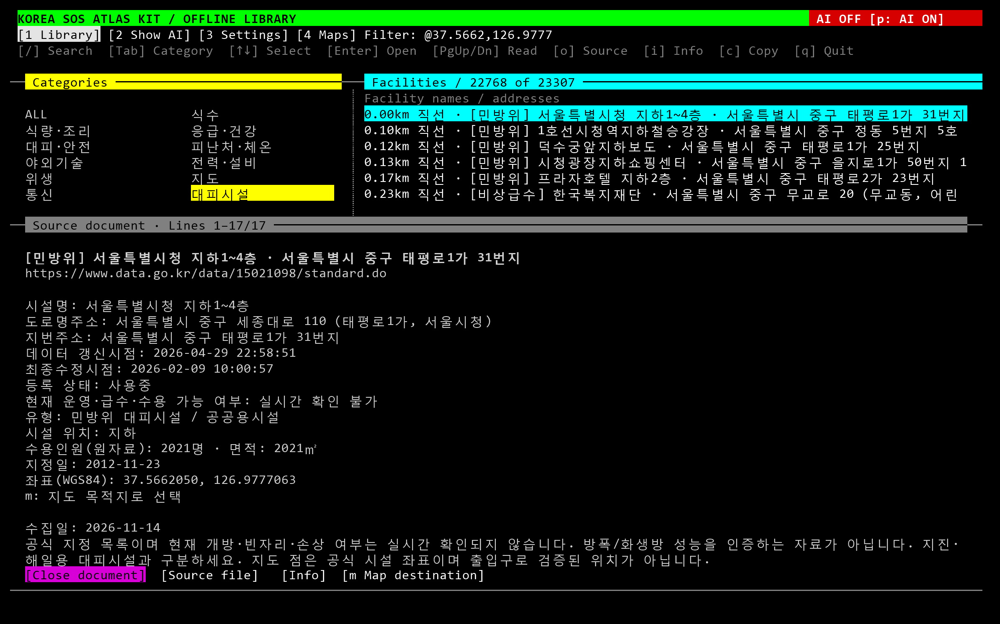
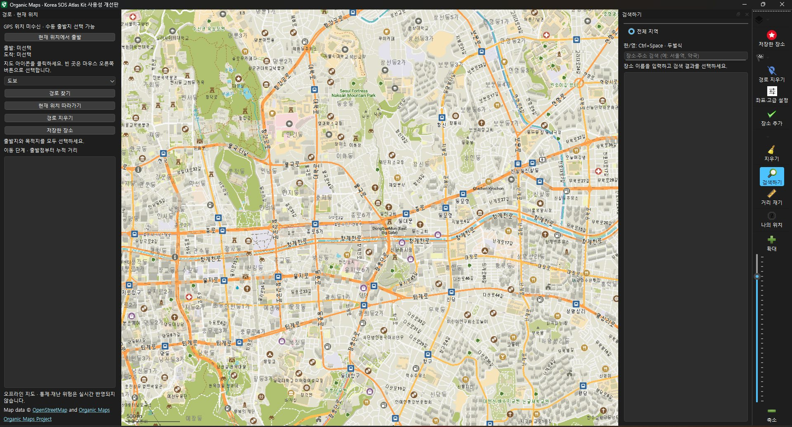

# Korea SOS Atlas Kit

인터넷이 끊긴 상황에서도 PC로 한국어 재난/생존 자료를 검색/열람하고 가까운 대피시설과 오프라인 지도를 확인하는 휴대용 앱. USB나 아무 폴더에 복사해 설치 없이 실행한다.


> 이 앱은 구조 요청 서비스가 아닙니다. 정부/지자체의 공식 안내가 있으면 그 안내를 먼저 따르세요. AI 답변은 실험 기능이며 답변 아래에 붙는 원문 자료가 우선합니다.

## 할 수 있는 것

- **자료 검색과 열람**: 정전/화재/지진/응급처치/한파/공습 대피 등 재난/생존 자료 404건을 한국어로 검색/열람. 자료마다 출처와 원문 포함.
- **대피시설 찾기**: 행정안전부 공공데이터의 민방위 대피시설/비상급수시설/응급의료기관 23,307곳을 이름/주소로 검색. 동네/도로/건물 이름이나 좌표를 기준으로 가까운 순 정렬.
- **오프라인 지도(Windows)**: Organic Maps를 일반 사용자가 쓰기 쉽게 개선한 판. 장소 검색, 도보/차량 경로, 대피시설을 목적지로 보내기 지원. 지도는 인터넷에 연결하지 않는다.
- **로컬 AI(Atlas + AI)**: PC 안에서만 도는 소형 모델(Gemma 4 E2B + llama.cpp)이 앱의 자료를 찾아 근거와 함께 답변. 인터넷을 쓰지 않고 켜기 전에는 실행되지 않는다.

| 대피시설 찾기 | 오프라인 지도 |
|---|---|
|  |  |

### 지도 사용성 개선

지도는 오픈소스 오프라인 지도 앱 [Organic Maps](https://github.com/organicmaps/organicmaps)(Apache-2.0, OpenStreetMap 데이터)의 데스크톱 판 기반. 원래 데스크톱 판은 개발/테스트용에 가까워 일반 사용자가 쓰기 어렵다. 그래서 원래 지도와 경로 엔진은 그대로 두고 화면과 동작의 사용성을 아래와 같이 개선했다.

| 개선한 점 | 내용 |
|---|---|
| 한국어 화면 | 메뉴/버튼/안내 한국어화. 원판 번역이 비어 있는 문구도 번역 |
| 장소 검색 | 검색칸을 처음부터 열어 두고 결과를 누르면 바로 지도로 이동 |
| 경로 찾기 | 출발/도착 선택 단추, 도보/차량 전환, 거리/예상 시간/이동 단계 표시 |
| 현재 위치 | GPS 수신 상태 표시. 위치가 없거나 오래됐으면 출발지를 직접 고르도록 안내 |
| 장소 저장 | 장소에 이름과 메모를 붙여 저장 |
| 가까운 대피시설 | 민방위 대피소/비상급수시설을 지도에 아이콘으로 표시. 검색한 장소나 출발지(없으면 지도 중심)에서 가까운 30곳을 거리순 목록으로 표시 |
| 키트 연결 | 앱에서 고른 대피시설을 바로 목적지로 표시(`m`). 설정은 휴대용 폴더 안에 저장 |
| 오프라인 고정 | 인터넷 요청 전체 차단. 내려받기/업데이트/업로드 기능 숨김 |
| 그래픽 문제 대응 | 드라이버가 없는 PC에서는 CPU 렌더러(Mesa)로 렌더링 |

Organic Maps 이름/로고/지도 고지는 그대로 유지하고 창 제목과 정보 화면에 수정판임을 표시한다. 개선 내용 전체는 [integrations/organicmaps/](integrations/organicmaps/README.md)에 패치로 공개. Windows 판은 GitHub Actions로 빌드한다.

### 가벼운 앱과 작은 AI 모델

재난 상황에서는 손에 잡히는 아무 PC나 써야 할 수 있다. 그래서 무겁지 않게 만들었다.

- **TUI(텍스트 화면)**: 웹 브라우저나 그래픽 화면 대신 터미널 글자 화면 사용.
  - 앱 자체는 실행 파일 하나(약 2MB)이고 메모리도 적게 쓴다.
  - 키보드만으로 모든 기능 사용 가능. 마우스도 지원.
- **소형 AI 모델**: 수십 GB짜리 대형 모델 대신 Google의 소형 모델 Gemma 4 E2B를 4비트로 줄인 파일(약 2.8GB) 사용.
  - 그래픽 카드 없이 일반 CPU로 동작. 답변 중 메모리 사용량 약 1.6GB.
  - 대신 대형 AI보다 느리고(답변까지 1분 안팎) 덜 정확할 수 있다. 그래서 앱의 자료를 찾아 근거를 붙여 답하도록 설계.
- **필요한 것만 받기**: AI가 필요 없으면 430MB짜리 Atlas만 받아도 자료/대피시설/지도를 모두 쓸 수 있다.

## 설치하기

### 1. 받기

[Releases](https://github.com/finddme/korea-sos-atlas-kit/releases) 페이지에서 필요한 파일을 받는다.

| 구성 | 받을 파일 | 크기 | 할 수 있는 것 |
|---|---|---|---|
| **Atlas** | `korea-sos-atlas-kit-atlas-windows-x64.zip` | 약 430MB | 자료 검색/열람, 대피시설 찾기, 지도 |
| **Atlas + AI** | 위 파일 + `korea-sos-atlas-kit-ai-pack-1.zip` + `korea-sos-atlas-kit-ai-pack-2.zip` | 약 3.2GB | Atlas 기능 + 로컬 AI 답변 |

- AI 없이도 자료/대피시설/지도는 모두 쓸 수 있다.
- AI 추가팩은 나중에 받아 더해도 된다.
- AI 추가팩 zip은 **풀지 않아도 된다**. 앱이 찾아서 설치한다(아래 4).

### 2. 압축 풀기

**Atlas zip 하나만** 압축 해제.

1. `korea-sos-atlas-kit-atlas-windows-x64.zip`을 마우스 오른쪽 단추로 누르고 **압축 풀기** 선택.
2. 원하는 위치(예: `D:\` 또는 USB 드라이브) 지정. 풀고 나면 `KoreaSOSAtlasKit` 폴더가 생긴다.

### 3. 실행

`KoreaSOSAtlasKit\korea-sos-atlas-kit.exe`를 더블클릭하면 검은 창(터미널)에 앱이 열린다.

- **"Windows의 PC 보호" 창이 뜨면**: 인터넷에서 받은 서명 없는 프로그램이라 Windows가 확인을 요청하는 것. **추가 정보** → **실행** 클릭.
  - 받은 파일이 맞는지는 Releases의 `SHA256SUMS.txt`와 비교해 확인(PowerShell: `Get-FileHash 파일이름`).
- 폴더째 USB에 복사하면 다른 Windows PC에서도 그대로 쓸 수 있다. 설치나 관리자 권한 불필요.
- 지원 운영체제: Windows 10/11 x64.

### 4. AI 추가팩 설치 (Atlas + AI)

1. AI 추가팩 zip 2개(`ai-pack-1`, `ai-pack-2`)는 받은 그대로 둔다.
   - 앱이 zip을 찾는 위치: **다운로드 폴더**, `KoreaSOSAtlasKit` 폴더, 그 위 폴더들.
   - 다른 곳에 받았다면 zip 2개를 `KoreaSOSAtlasKit` 폴더로 이동.
2. 앱에서 `p`를 누르면(또는 AI 칸에 질문을 쓰고 `Enter`) 찾은 zip 2개를 보여 주고 설치 여부를 묻는다.
   - `Enter`: zip 압축 해제 → 모든 파일의 SHA-256 확인 → AI 켜기.
   - 약 3GB 여유 공간 필요. 몇 분 걸릴 수 있다.
   - `p`로 취소 가능. 취소하거나 확인에 실패하면 키트 폴더는 설치 전 상태 그대로 남는다.
3. 설치가 끝나면 받은 zip 2개는 지워도 된다. 폴더째 USB에 복사하면 AI도 함께 옮겨진다.

zip 3개를 같은 위치에 직접 풀어도 된다. 세 zip 모두 안에 `KoreaSOSAtlasKit` 폴더가 있어 한 폴더로 합쳐진다. 이 경우 `data\models`에 모델 파일 2개가 있어야 한다.

## 사용 설명서

### 화면 구성

- **맨 위 줄**: 앱 이름과 AI 상태(`AI OFF`, `READY` 등).
- **둘째 줄**: `[1 Library]` 자료, `[2 Show AI]` AI 칸 열기/닫기, `[3 Status]` 키트 상태, `[4 Maps]` 지도 열기.
- **셋째 줄**: `[/] Search`, `[Tab] Category`, `[Enter] Open` 같은 키 안내.
  - 키를 몰라도 **마우스로 눌러서** 똑같이 쓸 수 있다. 목록/분류/단추도 모두 클릭 가능.
  - 누를 수 있는 곳은 마우스를 올리면 밑줄이나 색으로 표시된다.
- **화면 칸**

| 위치 | 이름 | 내용 |
|---|---|---|
| 왼쪽 위 | Categories | 분류 |
| 오른쪽 위 | Documents | 고른 분류의 자료 목록 |
| 아래 | Source document | 연 자료의 본문 |
| 아래 오른쪽 | (AI 칸을 열었을 때) | AI 답변 |

### 자료 찾기

1. `/`를 누르고 검색어 입력 후 `Enter`. 여러 단어를 쓰면 모두 들어 있는 자료만 표시(예: `정전 냉장고`).
2. `Tab`으로 분류 변경(식수, 응급·건강, 대피·안전 등).
3. 방향키나 마우스로 고르고 `Enter`로 열기. 긴 본문은 `PgUp`/`PgDn`이나 마우스 휠로 넘긴다.
4. `i`는 출처/이용 조건, `o`는 원문 파일, `c`는 본문 복사. 검색을 지우려면 `/`를 누르고 입력칸을 비운 채 `Enter`.

### 대피시설 찾기

1. `Tab`을 눌러 **대피시설** 분류로 이동.
2. `/`를 누르고 시설 이름이나 주소(예: `태평로`) 입력.
   - 기준 위치를 정하면 그곳에서 가까운 순서(직선거리)로 정렬된다.
   - 기준 위치 입력 예: `@강남역`, `@중구 태평로`처럼 `@` 뒤에 동네/도로/건물 이름, 또는 `@37.5662,126.9777`처럼 `@위도,경도`.
   - 동네 이름은 시설의 이름/주소에서 찾으므로 대략적인 위치다. 목록 위의 "기준 위치"를 확인하고 같은 이름이 여러 지역에 있으면 `@중구 태평로`처럼 지역을 붙인다.
   - 좌표가 기록되지 않은 시설(539곳)은 거리 정렬에서 빠지므로 이름/주소로 찾는다.
3. 시설을 열면 주소, 유형, 수용인원, 좌표 표시. `m`을 누르면 지도의 목적지로 보낸다.

목록은 공식 지정 시설이며 지금 문이 열려 있는지, 자리가 있는지는 알 수 없다. 현장 안내와 재난 방송을 함께 확인할 것.

### 지도

`4`(또는 `[4 Maps]`)로 지도를 연다. 처음 열 때 Organic Maps의 저작권/라이선스 고지가 뜨면 수락을 누른다.

- 오른쪽 검색칸에서 장소를 찾고 장소를 고른 뒤 출발/도착을 정하면 도보/차량 경로와 거리/예상 시간이 표시된다.
- 앱에서 대피시설을 `m`으로 보내면 그 위치가 목적지로 표시된다.
- 민방위 대피소(빨간 건물)와 비상급수시설(파란 물방울)은 동네 규모로 확대하면 지도에 보인다.
  - 장소를 검색해 고른 뒤 오른쪽 메뉴의 **가까운 대피시설**을 누르면 가까운 30곳이 거리순으로 표시된다.
  - 기준은 고른 장소이고 출발지를 정했으면 출발지, 아무것도 없으면 지도 중심이다.
  - 클릭하면 지도에서 보여 주고 두 번 클릭하면 도착지로 정한다.
  - 이 시설들은 **저장한 장소**에 시/도별 목록으로 들어 있다.
- 한국 밖 지역은 들어 있지 않다. 지도는 인터넷에 연결하지 않고 내려받기/업데이트 기능은 꺼 두었다.
- 그래픽 드라이버를 쓸 수 없는 PC에서는 자동으로 CPU 렌더링으로 다시 연다(느릴 수 있음).

### AI에게 묻기 (Atlas + AI)

1. `2`를 누르면 AI 칸이 열리고 아래 질문칸에 바로 입력할 수 있다.
2. 질문을 쓰고 `Enter`. AI가 꺼져 있으면 켠 뒤 준비되는 대로 답한다. 답변까지 보통 1분 안팎.
3. 답변 아래에 근거 자료가 붙는다.
   - 답변창 하단의 **[근거 원문 보기]**(또는 `s`)를 누르면 왼쪽에 근거 원문이 열린다.
   - 왼쪽 아래 **[1] [2] …**를 누르거나 `←` `→`로 원문을 차례로 본다.
   - `c`는 답변 복사, `p`는 AI 켜기/끄기.

AI는 PC 안에서 도는 소형 모델이라 대형 AI보다 느리고 답변이 안정적이지 않을 수 있다. 중요한 내용은 근거 원문을 꼭 확인할 것. "근처 대피소"처럼 위치를 묻는 질문에는 대피시설 검색 방법을 안내한다.

**메모리**: AI는 답하는 동안 약 1.6GB를 쓴다.

| 사용 가능한 메모리 | 동작 |
|---|---|
| 3GB 이상 | 바로 켜기 |
| 1.5~3GB | 느려질 수 있다고 알린 뒤 켤지 확인(`Enter` 켜기 / `Esc` 취소, 단추를 눌러도 됨) |
| 1.5GB 미만 | 켜지 않음 |
| 실행 중 0.5GB 아래로 떨어짐 | AI를 끄고 모델을 메모리에서 내림 |

앱 창을 닫으면 AI도 함께 종료된다.

### 키트 상태 (`[3 Status]`)

`3`을 누르면 이 키트의 상태를 한 화면에서 본다. 상태를 보는 화면이라 켜기/끄기 같은 조작은 없다.

- **Content**: 자료 수, 시설 수(대피/급수/의료), 공개 자료만 들어 있는지 여부
- **AI**
  - 켜짐/꺼짐 상태와 이유, 모델
  - AI 엔진이 실제로 실행 중인지 여부(꺼져 있으면 "종료됨 (모델 메모리 해제됨)")
  - 지금 켜면 바로 켜지는지, 확인을 묻는지, 켤 수 없는지
  - 켜기/끄기는 상단 "2 Show AI"에서 조작
- **Memory**
  - 사용 가능한 메모리 막대(흰 눈금은 AI 최소 1.5GB / 권장 3GB)
  - 최근 1분 동안의 변화(1초에 한 칸, 초록 충분 / 노랑 확인 / 빨강 부족)
  - AI 엔진이 쓰는 메모리
- **Map**
  - 지도 프로그램/지도 파일 버전
  - 그래픽 카드와 CPU 렌더링 중 어느 쪽으로 그리는지
  - CPU 렌더링으로 바뀌어 있으면 `[g Use graphics card]`로 다음부터 그래픽 카드를 다시 쓰게 설정 가능
- **Info**: 버전, 키트 폴더 위치, 지도 데이터 출처, 라이선스 안내와 `[l Open licenses folder]`

### 키 요약

| 키 | 동작 |
|---|---|
| `/` | 검색 |
| `Tab` | 분류 바꾸기 |
| 방향키, 마우스 | 이동, 선택 |
| `Enter` | 열기 |
| `PgUp` `PgDn`, 마우스 휠 | 본문 넘기기 |
| `i` | 출처 정보 |
| `o` | 원문 파일 열기 |
| `c` | 복사(AI 칸이 열려 있으면 답변, 아니면 열린 문서) |
| `m` | 대피시설을 지도 목적지로 |
| `2` | AI 칸 열기/닫기 |
| `p` | AI 켜기/끄기 |
| `s` | AI 답변의 근거 원문 보기(왼쪽에 [1] [2] … 순서로, `←` `→`로 이동) |
| `3` | 키트 상태 보기 |
| `4` | 지도 열기 |
| `q` | 종료 |

## 자료 구성

재배포/번역/편집이 모두 허용된 공개 자료만 수록. 해외 자료는 한국어로 옮기고 맨 위에 "대한민국에서 적용하기"를 두어 국내 연락처(119·112 등)와 절차로 바꿔 읽도록 했다.

| 구분 | 수 | 내용 |
|---|---:|---|
| 공개 자료 | 105건 | 질병관리청/소방청/행정안전부, 영국 NHS/UKHSA/외교부, 미국 FDA/NWS/NPS, EU 집행위원회, 뉴질랜드 민방위청, Wikibooks/Wikivoyage 등 |
| 미군 생존 교범 2종 | 299항목 | 미 육군 ATP 3-50.21(2018), 미 해병대 MCRP 3-02H(1999 구판). 퍼블릭 도메인 |
| 대피/급수/의료 시설 | 23,307곳 | 민방위 대피시설 17,241곳, 비상급수시설 5,787곳, 응급의료기관 279곳(공공데이터포털, 2026-11-14 수집) |
| 오프라인 지도 | 한국 전역 | OpenStreetMap 기반 Organic Maps 지도 데이터 |

분류별 자료 수(한 자료가 여러 분류에 들어갈 수 있음):

| 응급·건강 | 식량·조리 | 야외기술 | 대피·안전 | 지도 | 식수 | 피난처·체온 | 통신 | 전력·설비 | 위생 |
|---:|---:|---:|---:|---:|---:|---:|---:|---:|---:|
| 105 | 70 | 67 | 57 | 48 | 37 | 32 | 17 | 11 | 11 |

자료의 날짜/수치/연락처는 수집 시점 기준. 실시간 경보/통제/대피소 개방 여부는 재난 방송과 현장 안내를 따를 것.

```text
KoreaSOSAtlasKit/
  korea-sos-atlas-kit.exe       실행 파일
  README.md, LICENSING.md, LICENSES/
  data/
    assets.json                 AI 모델·엔진·지도 프로그램의 SHA-256 목록
    content-library/            자료(공개 승인 자료만)와 자료별 NOTICE.txt
    runtime/organicmaps-win-x64 지도 프로그램
    runtime/llama.cpp-win-x64   AI 추론 엔진 (AI 추가팩)
    models/                     AI 모델 2조각 (AI 추가팩)
```

## 문제 해결

| 증상 | 해결 |
|---|---|
| "Windows의 PC 보호" 창이 뜸 | **추가 정보** → **실행**. 받은 파일이 맞는지는 `SHA256SUMS.txt`로 확인 |
| AI를 켜면 "AI 추가팩이 없습니다" | AI 추가팩 zip 2개를 받아 다운로드 폴더나 `KoreaSOSAtlasKit` 폴더에 두고 다시 `p`. 파일 이름을 바꿨다면 `korea-sos-atlas-kit-ai-pack-1.zip`, `-2.zip`으로 복원 |
| AI 추가팩 설치가 "해시가 … 다릅니다"로 멈춤 | 받는 중 파일이 손상됐거나 다른 버전의 zip. Atlas와 같은 릴리스의 AI 추가팩을 다시 받기 |
| "저장 공간이 부족합니다" | 키트가 있는 드라이브에 약 3GB 확보. 또는 여유가 있는 드라이브로 `KoreaSOSAtlasKit` 폴더를 옮긴 뒤 다시 `p` |
| AI가 메모리 부족이라며 켜지지 않음 | 브라우저 창 등 다른 프로그램을 닫은 뒤 다시 `p` |
| 지도가 열리지 않거나 하얀 화면 | 지도 창을 닫고 다시 `4`. 그래픽 문제로 바로 꺼지면 앱이 CPU 렌더링으로 다시 연다. 그래픽 카드로 되돌리려면 `[3 Status]`에서 `[g Use graphics card]` |
| 한글이 깨지거나 칸이 어긋남 | Windows Terminal에서 실행하거나 창 크기 확대 |
| AI가 실제로 도는지 화면 없이 확인 | 명령 프롬프트에서 `korea-sos-atlas-kit.exe --ai-check` |

## 소스에서 빌드

Rust(Cargo) 필요.

```sh
./build.sh
```

배포판에 들어가는 구성 요소의 빌드 방법:

- Windows용 llama.cpp 엔진: [integrations/llama.cpp/build-windows.sh](integrations/llama.cpp/build-windows.sh)
- Organic Maps 수정판: [integrations/organicmaps/](integrations/organicmaps/README.md) (GitHub Actions로 빌드)

자료/모델/지도 데이터는 크기와 권리 조건 때문에 이 저장소에 넣지 않고 배포판으로 제공한다.

배포판의 앱 실행 파일 `korea-sos-atlas-kit.exe`는 GitHub Actions([.github/workflows/app-windows.yml](.github/workflows/app-windows.yml))가 이 저장소의 소스에서 빌드한다.

- 빌드 도구: 버전을 고정한 Rust 1.90.0과 llvm-mingw(SHA-256 확인)
- 파일 속성에 제품명과 버전 포함

## Code signing policy

Free code signing provided by [SignPath.io](https://about.signpath.io), certificate by [SignPath Foundation](https://signpath.org).

> SignPath Foundation에 무료 코드 서명을 신청하는 중. 승인 전에 나온 배포판(v0.1.0 포함)은 서명되지 않았다.

- **서명하는 파일**: 이 저장소의 소스에서 GitHub Actions가 빌드한 앱 실행 파일 `korea-sos-atlas-kit.exe` 하나.
  - 배포판에 함께 들어 있는 다른 프로젝트의 프로그램은 이 프로젝트가 만든 것이 아니므로 서명하지 않고 원래 상태 그대로 포함.
  - 해당 프로그램: Organic Maps 수정판, Qt, Mesa, Visual C++ 런타임, llama.cpp.
- **역할**
  - Committers and reviewers: [finddme](https://github.com/finddme)
  - Approvers: [finddme](https://github.com/finddme)
  - 서명 요청은 릴리스마다 승인자가 직접 승인. 저장소와 SignPath 계정은 모두 2단계 인증(MFA) 사용.
- **Privacy policy**: This program will not transfer any information to other networked systems unless specifically requested by the user or the person installing or operating it.
  - 이 앱은 인터넷을 쓰지 않는다.
  - 함께 들어 있는 지도 프로그램은 키트가 오프라인 모드로 실행해 모든 HTTP 연결을 차단.
  - AI 엔진은 이 PC 안에서만(127.0.0.1) 동작.

## 라이선스

앱은 **AGPL-3.0-only**. 자료, 지도 데이터, 모델, 엔진은 각각의 조건을 따르며 앱 라이선스로 바뀌지 않는다. [라이선스 범위](LICENSING.md)와 [LICENSES/](LICENSES/) 참고.

**자료**

- 라이선스별 조건, 그 조건을 지킨 방법, 자료 105건의 목록: [LICENSES/CONTENT.md](LICENSES/CONTENT.md)
- 자료마다의 출처/이용 조건/편집 내역: 앱의 출처 정보(`i`)와 자료 폴더의 `NOTICE.txt`

| 이용 조건 | 예 |
|---|---|
| 영국 정부 Open Government Licence v3.0 | NHS, UKHSA, 영국 외교부 |
| CC BY 4.0 / 3.0 | EU 집행위원회, 뉴질랜드 민방위청, 남호주 소방청 |
| CC BY-SA 4.0 | Wikibooks, Wikivoyage. 한국어 편집본도 CC BY-SA 4.0 |
| 공공누리 제0·1유형 | 질병관리청, 소방청, 행정안전부 등 |
| 미국 연방정부 저작물(퍼블릭 도메인) | FDA, NPS, NWS, 국토안보부, 미군 교범 |
| 공공데이터포털 "이용허락범위 제한 없음" | 민방위 대피/급수시설, 응급의료기관 |

한국어 편집본은 원 기관의 공식 번역이나 승인본이 아니며 원 기관이 보증하지 않는다. 사진/로고/제3자 자료는 수록하지 않았다.

**지도**: Organic Maps 수정판(Apache-2.0)과 OpenStreetMap 기반 지도 데이터(ODbL, Organic Maps Binary Data License). 지도 프로그램 폴더의 `licenses/`에 Qt, Mesa, Visual C++ 런타임 등의 고지 포함.

**AI**: 모델 Gemma 4 E2B(Apache-2.0), 엔진 llama.cpp(MIT). [LICENSES/MODELS.md](LICENSES/MODELS.md) 참고.
