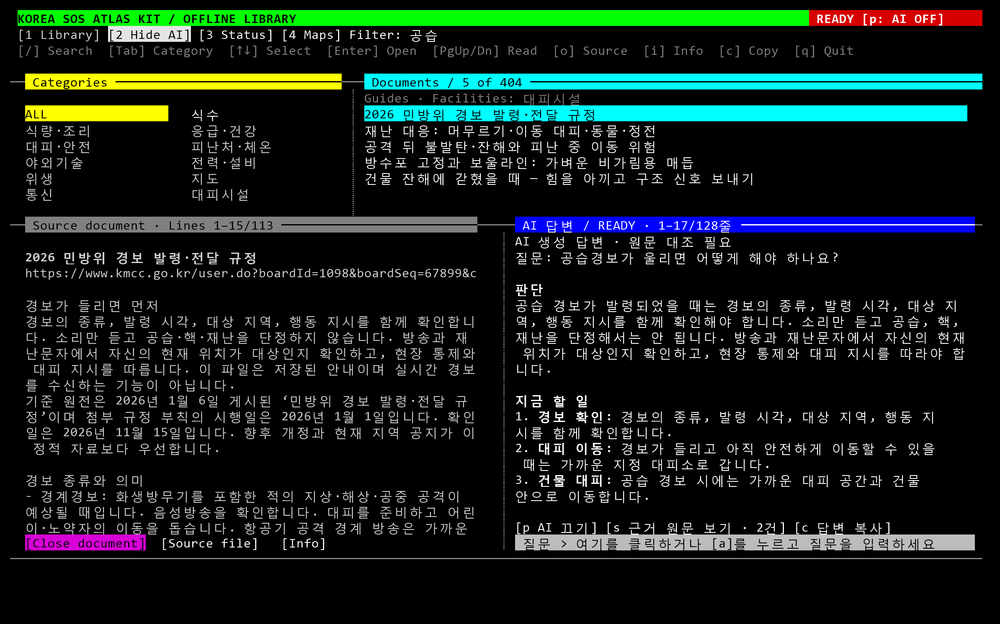

# Korea SOS Atlas Kit

인터넷이 끊긴 상황에서도 PC에서 한국어 재난·생존 자료를 찾아 읽고, 가까운 대피시설과 오프라인 지도를 확인할 수 있는 휴대용 앱입니다. USB나 아무 폴더에 복사해서 설치 없이 실행합니다.



> 이 앱은 구조 요청 서비스가 아닙니다. 위급할 때는 119·112에 먼저 연락하세요. AI 답변은 실험 기능이며, 답변 아래에 붙는 원문 자료가 우선합니다.

## 할 수 있는 것

- **자료 검색과 열람**: 정전·화재·지진·응급처치·한파·공습 대피 같은 재난·생존 자료 404건을 한국어로 검색하고 읽습니다. 자료마다 출처와 원문이 함께 있습니다.
- **대피시설 찾기**: 행정안전부 공공데이터의 민방위 대피시설, 비상급수시설, 응급의료기관 23,307곳을 이름·주소로 찾고, 좌표를 넣으면 가까운 순서로 보여 줍니다.
- **오프라인 지도(Windows)**: Organic Maps를 일반 사용자가 쓰기 쉽게 개선한 판으로 장소 검색, 도보·차량 경로, 대피시설을 목적지로 보내기를 합니다. 지도는 인터넷에 연결하지 않습니다.
- **로컬 AI(Atlas + AI)**: PC 안에서만 도는 소형 모델(Gemma 4 E2B + llama.cpp)이 앱의 자료를 찾아 근거와 함께 답합니다. 인터넷을 쓰지 않으며, 켜기 전에는 실행되지 않습니다.

| 대피시설 찾기 | 오프라인 지도 |
|---|---|
|  |  |

### 지도 사용성 개선

지도는 오픈소스 오프라인 지도 앱 [Organic Maps](https://github.com/organicmaps/organicmaps)(Apache-2.0, OpenStreetMap 데이터)의 데스크톱 판을 바탕으로 합니다. 원래 데스크톱 판은 개발·테스트용에 가까워 일반 사용자가 쓰기 어렵기 때문에, 원래 지도와 경로 엔진은 그대로 두고 화면과 동작의 사용성을 다음처럼 개선했습니다.

| 개선한 점 | 내용 |
|---|---|
| 한국어 화면 | 메뉴·버튼·안내를 한국어로. 원판 번역이 비어 있는 문구도 채움 |
| 장소 검색 | 검색칸을 처음부터 열어 두고, 결과를 눌러 바로 지도로 이동 |
| 경로 찾기 | 출발·도착 선택 단추, 도보/차량 전환, 거리·예상 시간·이동 단계 표시 |
| 현재 위치 | GPS 수신 상태를 표시하고, 위치가 없거나 오래됐으면 출발지를 직접 고르게 안내 |
| 장소 저장 | 장소에 이름과 메모를 붙여 저장 |
| 키트 연결 | 앱에서 고른 대피시설을 목적지로 바로 표시(`m`), 설정을 휴대용 폴더 안에 저장 |
| 오프라인 고정 | 인터넷 요청을 모두 막고 내려받기·업데이트·업로드 기능을 숨김 |
| 그래픽 문제 대응 | 드라이버가 없는 PC에서 CPU 렌더러(Mesa)로 그리기 |

Organic Maps 이름·로고·지도 고지는 그대로 두고, 창 제목과 정보 화면에 수정판임을 표시합니다. 개선 내용 전체는 [integrations/organicmaps/](integrations/organicmaps/README.md)에 패치로 공개되어 있고, Windows 판은 GitHub Actions로 빌드합니다.

### 오래된 PC에서도 돌도록 가볍게

재난 상황에서는 아무 PC나 손에 잡히는 대로 써야 할 수 있습니다. 그래서 무겁지 않게 만들었습니다.

- **TUI(텍스트 화면)**: 웹 브라우저나 그래픽 화면 대신 터미널 글자 화면으로 만들어, 앱 자체는 실행 파일 하나(약 2MB)에 메모리도 적게 씁니다. 키보드만으로 다 쓸 수 있고 마우스도 됩니다.
- **소형 AI 모델**: 수십 GB짜리 대형 모델 대신 Google의 소형 모델 Gemma 4 E2B를 4비트로 줄인 파일(약 2.8GB)을 씁니다. 그래픽 카드 없이 일반 CPU로 돌고, 답하는 동안 메모리 약 1.6GB를 씁니다. 대신 대형 AI보다 느리고(답변까지 1분 안팎) 덜 정확할 수 있어서, 앱의 자료를 찾아 근거를 붙여 답하게 했습니다.
- **필요한 것만 받기**: AI가 필요 없으면 430MB짜리 Atlas만 받아도 자료·대피시설·지도를 모두 씁니다.

## 설치하기

### 1. 받기

[Releases](https://github.com/finddme/korea-sos-atlas-kit/releases) 페이지에서 필요한 파일을 받습니다.

| 구성 | 받을 파일 | 크기 | 할 수 있는 것 |
|---|---|---|---|
| **Atlas** | `korea-sos-atlas-kit-atlas-windows-x64.zip` | 약 430MB | 자료 검색·열람, 대피시설 찾기, 지도 |
| **Atlas + AI** | 위 파일 + `korea-sos-atlas-kit-ai-pack-1.zip` + `korea-sos-atlas-kit-ai-pack-2.zip` | 약 3.2GB | Atlas 기능 + 로컬 AI 답변 |

AI 없이도 자료·대피시설·지도는 모두 씁니다. AI 추가팩은 나중에 받아 더해도 됩니다.

### 2. 압축 풀기

받은 zip을 **모두 같은 위치**에 풉니다. 세 파일 모두 안에 `KoreaSOSAtlasKit` 폴더가 있어서, 같은 위치에 풀면 한 폴더로 합쳐집니다.

1. zip 파일을 마우스 오른쪽 단추로 누르고 **압축 풀기**를 고릅니다.
2. 위치 입력칸 끝에 붙는 zip 이름(예: `\korea-sos-atlas-kit-atlas-windows-x64`)을 지우고, 세 파일 모두 **같은 위치**(예: `D:\` 또는 USB 드라이브)를 지정합니다.
3. 풀고 나면 `KoreaSOSAtlasKit` 폴더 하나가 생깁니다. AI 추가팩까지 풀었다면 그 안의 `data\models`에 모델 파일 2개가 있어야 합니다.

### 3. 실행

`KoreaSOSAtlasKit\korea-sos-atlas-kit.exe`를 더블클릭합니다. 검은 창(터미널)에 앱이 열립니다.

- **"Windows의 PC 보호" 창이 뜨면**: 인터넷에서 받은 서명 없는 프로그램이라 Windows가 확인을 요청하는 것입니다. **추가 정보** → **실행**을 누르세요. 받은 파일이 맞는지는 Releases의 `SHA256SUMS.txt`와 비교해 확인할 수 있습니다(PowerShell: `Get-FileHash 파일이름`).
- 폴더째 USB에 복사하면 다른 Windows PC에서도 그대로 씁니다. 설치나 관리자 권한이 필요 없습니다.
- 지원 운영체제: Windows 10/11 x64.

## 사용 설명서

### 화면 구성

- **맨 위 줄**: 앱 이름과 AI 상태(`AI OFF`, `READY` 등).
- **둘째 줄**: `[1 Library]` 자료, `[2 Show AI]` AI 칸 열기·닫기, `[3 Status]` 키트 상태, `[4 Maps]` 지도 열기.
- **셋째 줄**: `[/] Search`, `[Tab] Category`, `[Enter] Open` 같은 키 안내. 키를 몰라도 **마우스로 눌러서** 똑같이 쓸 수 있습니다. 목록·분류·단추도 모두 클릭되고, 누를 수 있는 곳은 마우스를 올리면 밑줄이나 색으로 표시됩니다.
- **왼쪽 위 Categories**: 분류. **오른쪽 위 Documents**: 고른 분류의 자료 목록. **아래 Source document**: 연 자료의 본문. AI 칸을 열면 아래 오른쪽에 AI 답변이 나옵니다.

### 자료 찾기

1. `/`를 누르고 검색어를 입력한 뒤 `Enter`를 누릅니다. 여러 단어를 쓰면 모두 들어 있는 자료만 나옵니다(예: `정전 냉장고`).
2. `Tab`으로 분류를 바꿀 수 있습니다(식수, 응급·건강, 대피·안전 등).
3. 방향키나 마우스로 고르고 `Enter`로 엽니다. 긴 본문은 `PgUp`/`PgDn`이나 마우스 휠로 읽습니다.
4. `i`는 출처·이용 조건, `o`는 원문 파일, `c`는 본문 복사입니다. 검색을 지우려면 `/`를 누르고 입력칸을 비운 채 `Enter`를 누릅니다.

### 대피시설 찾기

1. `Tab`을 눌러 **대피시설** 분류로 갑니다.
2. `/`를 누르고 시설 이름이나 주소(예: `태평로`)를 입력합니다. 좌표를 알면 `@37.5662,126.9777`처럼 `@위도,경도`로 넣으면 가까운 순서(직선거리)로 정렬됩니다. 좌표가 기록되지 않은 시설(539곳)은 좌표 검색에서 빠지므로 이름·주소로 찾습니다.
3. 시설을 열면 주소, 유형, 수용인원, 좌표가 나옵니다. `m`을 누르면 지도의 목적지로 보냅니다.

목록은 공식 지정 시설이며, 지금 문이 열려 있는지·자리가 있는지는 알 수 없습니다. 현장 안내와 재난 방송을 함께 확인하세요.

### 지도

`4`(또는 `[4 Maps]`)로 지도를 엽니다. 처음 열 때 Organic Maps의 저작권·라이선스 고지가 뜨면 수락을 누르세요.

- 오른쪽 검색칸에서 장소를 찾고, 장소를 고른 뒤 출발·도착을 정하면 도보·차량 경로와 거리·예상 시간이 나옵니다.
- 앱에서 대피시설을 `m`으로 보내면 그 위치가 목적지로 표시됩니다.
- 한국 밖 지역은 들어 있지 않습니다. 지도는 인터넷에 연결하지 않고, 내려받기·업데이트 기능을 꺼 두었습니다.
- 그래픽 드라이버를 쓸 수 없는 PC에서는 자동으로 CPU 렌더링으로 다시 엽니다(느릴 수 있음).

### AI에게 묻기 (Atlas + AI)

1. `2`를 누르면 AI 칸이 열리고 아래 질문칸에 바로 입력할 수 있습니다.
2. 질문을 쓰고 `Enter`를 누릅니다. AI가 꺼져 있으면 켠 뒤 준비되는 대로 답합니다. 답변까지 보통 1분 안팎입니다.
3. 답변 아래에 근거 자료가 붙습니다. 답변창 하단의 **[근거 원문 보기]**(또는 `s`)를 누르면 왼쪽에 근거 원문이 열리고, 왼쪽 아래 **[1] [2] …**를 누르거나 `←` `→`로 원문을 차례로 봅니다. `c`는 답변 복사, `p`는 AI 켜기·끄기입니다.

AI는 PC 안에서 도는 소형 모델이라 대형 AI보다 느리고 답변이 안정적이지 않을 수 있습니다. 중요한 내용은 근거 원문을 꼭 확인하세요. "근처 대피소"처럼 위치를 묻는 질문에는 대피시설 검색 방법을 안내합니다.

**메모리**: AI는 답하는 동안 약 1.6GB를 씁니다. 사용 가능한 메모리가 3GB 이상이면 바로 켜고, 1.5~3GB이면 느려질 수 있다고 알린 뒤 켤지 묻고(`Enter` 켜기 · `Esc` 취소, 단추를 눌러도 됨), 1.5GB 미만이면 켜지 않습니다. 실행 중 0.5GB 아래로 떨어지면 AI를 끄고 모델을 메모리에서 내립니다. 앱 창을 닫으면 AI도 함께 종료됩니다.

### 키트 상태 (`[3 Status]`)

`3`을 누르면 이 키트의 상태를 한 화면에서 봅니다. 상태를 보는 화면이라 켜기·끄기 같은 조작은 없습니다.

- **Content**: 자료·시설 수, 공개 자료만 들어 있는지
- **AI**: AI 추가팩·모델, 켜짐/꺼짐 상태와 이유, AI 엔진이 실제로 실행 중인지와 메모리 사용량(꺼져 있으면 "종료됨 — 모델이 메모리에 올라가 있지 않습니다"), 지금 사용 가능한 메모리로 켤 수 있는지. 켜기·끄기는 상단 "2 Show AI"에서 조작합니다
- **Map**: 지도 프로그램·지도 파일 버전, 그래픽 카드/CPU 렌더링 중 어느 쪽으로 그리는지. CPU 렌더링으로 바뀌어 있으면 `[g Use graphics card]`로 다음부터 그래픽 카드를 다시 쓰게 할 수 있습니다
- **Info**: 버전, 키트 폴더 위치, 지도 데이터 출처, 라이선스 안내와 `[l Open licenses folder]`

### 키 요약

| 키 | 동작 |
|---|---|
| `/` | 검색 |
| `Tab` | 분류 바꾸기 |
| 방향키, 마우스 | 이동, 선택 |
| `Enter` | 열기 |
| `PgUp` `PgDn`, 마우스 휠 | 본문 넘기기 |
| `i` | 출처 정보 |
| `o` | 원문 파일 열기 |
| `c` | 복사(AI 칸이 열려 있으면 답변, 아니면 열린 문서) |
| `m` | 대피시설을 지도 목적지로 |
| `2` | AI 칸 열기·닫기 |
| `p` | AI 켜기·끄기 |
| `s` | AI 답변의 근거 원문 보기(왼쪽에 [1] [2] … 순서로, `←` `→`로 옮김) |
| `3` | 키트 상태 보기 |
| `4` | 지도 열기 |
| `q` | 종료 |

## 자료 구성

재배포·번역·편집이 모두 허용된 공개 자료만 넣었습니다. 해외 자료는 한국어로 옮기고, 맨 위에 "대한민국에서 적용하기"를 두어 국내 연락처(119·112 등)와 절차로 바꿔 읽게 했습니다.

| 구분 | 수 | 내용 |
|---|---:|---|
| 공개 자료 | 105건 | 질병관리청·소방청·행정안전부, 영국 NHS·UKHSA·외교부, 미국 FDA·NWS·NPS, EU 집행위원회, 뉴질랜드 민방위청, Wikibooks·Wikivoyage 등 |
| 미군 생존 교범 2종 | 299항목 | 미 육군 ATP 3-50.21(2018), 미 해병대 MCRP 3-02H(1999 구판). 퍼블릭 도메인 |
| 대피·급수·의료 시설 | 23,307곳 | 민방위 대피시설 17,241곳, 비상급수시설 5,787곳, 응급의료기관 279곳(공공데이터포털, 2026-11-14 수집) |
| 오프라인 지도 | 한국 전역 | OpenStreetMap 기반 Organic Maps 지도 데이터 |

분류별 자료 수(한 자료가 여러 분류에 들어갈 수 있음):

| 응급·건강 | 식량·조리 | 야외기술 | 대피·안전 | 지도 | 식수 | 피난처·체온 | 통신 | 전력·설비 | 위생 |
|---:|---:|---:|---:|---:|---:|---:|---:|---:|---:|
| 105 | 70 | 67 | 57 | 48 | 37 | 32 | 17 | 11 | 11 |

자료의 날짜·수치·연락처는 수집 시점 기준입니다. 실시간 경보·통제·대피소 개방 여부는 재난 방송과 현장 안내를 따르세요.

```text
KoreaSOSAtlasKit/
  korea-sos-atlas-kit.exe       실행 파일
  README.md, LICENSING.md, LICENSES/
  data/
    assets.json                 AI 모델·엔진·지도 프로그램의 SHA-256 목록
    content-library/            자료(공개 승인 자료만)와 자료별 NOTICE.txt
    runtime/organicmaps-win-x64 지도 프로그램
    runtime/llama.cpp-win-x64   AI 추론 엔진 (AI 추가팩)
    models/                     AI 모델 2조각 (AI 추가팩)
```

## 문제 해결

| 증상 | 해결 |
|---|---|
| "Windows의 PC 보호" 창이 뜸 | **추가 정보** → **실행**. 받은 파일이 맞는지는 `SHA256SUMS.txt`로 확인 |
| AI를 켜면 "AI 추가팩이 없습니다" | AI 추가팩 2개를 받아 Atlas와 **같은 위치**에 풀었는지, `data\models`에 파일 2개가 있는지 확인 |
| AI가 메모리 부족이라며 켜지지 않음 | 브라우저 창 등 다른 프로그램을 닫은 뒤 다시 `p` |
| 지도가 열리지 않거나 하얀 화면 | 지도 창을 닫고 다시 `4`. 그래픽 문제로 바로 꺼지면 앱이 CPU 렌더링으로 다시 엽니다. 그래픽 카드로 되돌리려면 `[3 Status]`에서 `[g Use graphics card]` |
| 한글이 깨지거나 칸이 어긋남 | Windows Terminal에서 실행하거나 창 크기를 키워 보세요 |
| AI가 실제로 도는지 화면 없이 확인 | 명령 프롬프트에서 `korea-sos-atlas-kit.exe --ai-check` |

## 소스에서 빌드

Rust(Cargo)가 필요합니다.

```sh
./build.sh
```

배포판에 들어가는 구성 요소의 빌드 방법은 다음에 있습니다.

- Windows용 llama.cpp 엔진: [integrations/llama.cpp/build-windows.sh](integrations/llama.cpp/build-windows.sh)
- Organic Maps 수정판: [integrations/organicmaps/](integrations/organicmaps/README.md) (GitHub Actions로 빌드)

자료·모델·지도 데이터는 크기와 권리 조건 때문에 이 저장소에 넣지 않고 배포판으로 제공합니다.

## 라이선스

앱은 **AGPL-3.0-only**입니다. 자료, 지도 데이터, 모델, 엔진은 각각의 조건을 따르며 앱 라이선스로 바뀌지 않습니다. [라이선스 범위](LICENSING.md)와 [LICENSES/](LICENSES/)를 확인하세요.

**자료**: 라이선스별 조건과 그 조건을 어떻게 지켰는지, 자료 105건의 목록은 [LICENSES/CONTENT.md](LICENSES/CONTENT.md)에 정리했습니다. 자료마다 출처·이용 조건·편집 내역은 앱의 출처 정보(`i`)와 자료 폴더의 `NOTICE.txt`에도 있습니다.

| 이용 조건 | 예 |
|---|---|
| 영국 정부 Open Government Licence v3.0 | NHS, UKHSA, 영국 외교부 |
| CC BY 4.0 / 3.0 | EU 집행위원회, 뉴질랜드 민방위청, 남호주 소방청 |
| CC BY-SA 4.0 | Wikibooks, Wikivoyage. 한국어 편집본도 CC BY-SA 4.0 |
| 공공누리 제0·1유형 | 질병관리청, 소방청, 행정안전부 등 |
| 미국 연방정부 저작물(퍼블릭 도메인) | FDA, NPS, NWS, 국토안보부, 미군 교범 |
| 공공데이터포털 "이용허락범위 제한 없음" | 민방위 대피·급수시설, 응급의료기관 |

한국어 편집본은 원 기관의 공식 번역이나 승인본이 아니며, 원 기관이 보증하지 않습니다. 사진·로고·제3자 자료는 넣지 않았습니다.

**지도**: Organic Maps 수정판(Apache-2.0)과 OpenStreetMap 기반 지도 데이터(ODbL, Organic Maps Binary Data License). 지도 프로그램 폴더의 `licenses/`에 Qt, Mesa, Visual C++ 런타임 등의 고지가 함께 있습니다. **AI**: 모델 Gemma 4 E2B(Apache-2.0), 엔진 llama.cpp(MIT). [LICENSES/MODELS.md](LICENSES/MODELS.md)를 확인하세요.
